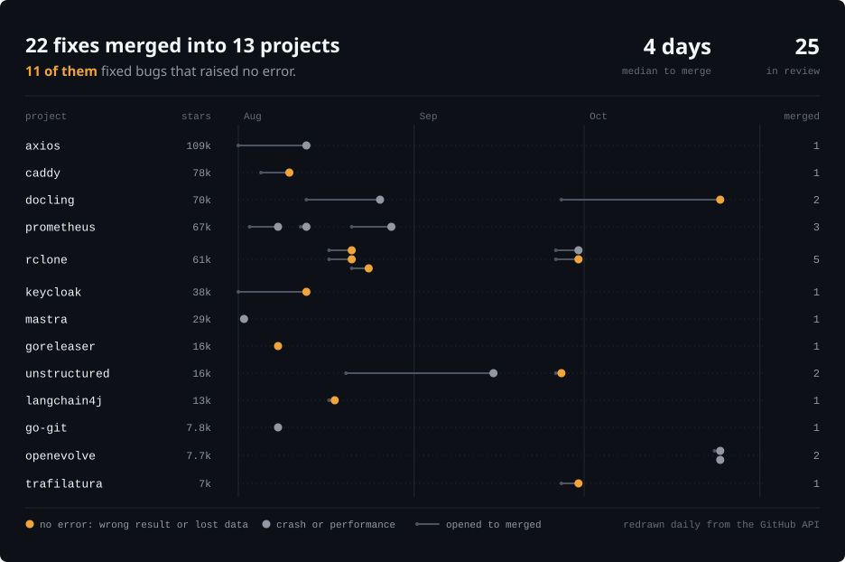

<samp>backend engineer · java · spring boot · postgres · rabbitmq · kafka · chennai</samp>

I finish things. Give me a broken service or a bug nobody has picked up: I'll find the cause, write the test that proves it, and ship the fix. Before this, 3 years of payment and account APIs at a global bank. **Open to backend roles, available now.**

<samp><a href="https://r0h1tb.github.io">site</a> · <a href="https://r0h1tb.github.io/ask/">ask my work</a> · <a href="https://www.linkedin.com/in/rohit-behera-64877b182/">linkedin</a> · <a href="mailto:rohit.behera12232@gmail.com">email</a></samp>

<table><tr><td valign="top" width="50%">

**Merged upstream**

<!-- merged starts -->
[rclone #9986](https://github.com/rclone/rclone/pull/9986) fix durations like 1d12h being rejected Sep 30 
[rclone #9987](https://github.com/rclone/rclone/pull/9987) fix --bwlimit timetables written out of order using the wrong limit Sep 30 
[trafilatura #940](https://github.com/adbar/trafilatura/pull/940) keep text that directly follows a list, table, quote or code block Sep 30 
[unstructured #4502](https://github.com/Unstructured-IO/unstructured/pull/4502) extract definition lists instead of discarding them Sep 27 
[unstructured #4449](https://github.com/Unstructured-IO/unstructured/pull/4449) run the spaCy pipeline once per distinct text Sep 15 
[prometheus #19486](https://github.com/prometheus/prometheus/pull/19486) run tests in parallel Aug 28
<!-- merged ends -->

</td><td valign="top" width="50%">

**In review**

<!-- review starts -->
[gcfg #16](https://github.com/go-git/gcfg/pull/16) Read a leading BOM and continued values the way git does Oct 19 
[rclone #10141](https://github.com/rclone/rclone/pull/10141) return 416 for ranges --rc-serve and serve restic can't satisfy Oct 19 
[qdrant-client #1606](https://github.com/qdrant/qdrant-client/pull/1606) preserve persisted metadata when saves fail Oct 19 
[xgrammar #997](https://github.com/mlc-ai/xgrammar/pull/997) enforce integer multipleOf with one-sided and large ranges Oct 18 
[aisuite #424](https://github.com/andrewyng/aisuite/pull/424) preserve text across Bedrock response blocks Oct 18 
[llama-agents #813](https://github.com/run-llama/llama-agents/pull/813) resolve resources safely across concurrent workflow steps Oct 16
<!-- review ends -->

</td></tr></table>

**Building**

<!-- building starts -->
[splitlint](https://github.com/r0h1tb/splitlint) finds the Unicode bugs in RAG text splitters updated Sep 9 
[plumb](https://github.com/r0h1tb/plumb) makes AI coding agents prove a task is actually done updated Aug 16 
[r0h1tb.github.io](https://github.com/r0h1tb/r0h1tb.github.io) my site: a failure lab, retrieval with evals updated Oct 7 
[raged](https://github.com/lexasub/raged/pulls?q=is%3Apr+author%3Ar0h1tb+is%3Amerged) code search for AI agents, 25 of my PRs merged
<!-- building ends -->

<!-- totals starts -->
19 fixes merged into 12 projects · 20 in review · kept current daily by [a script](build_readme.py), not by hand
<!-- totals ends -->
